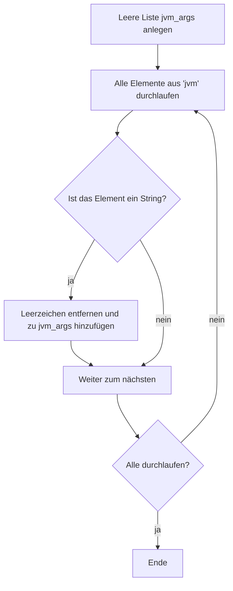
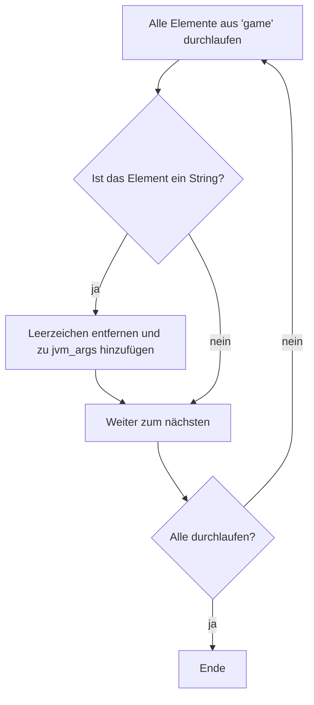
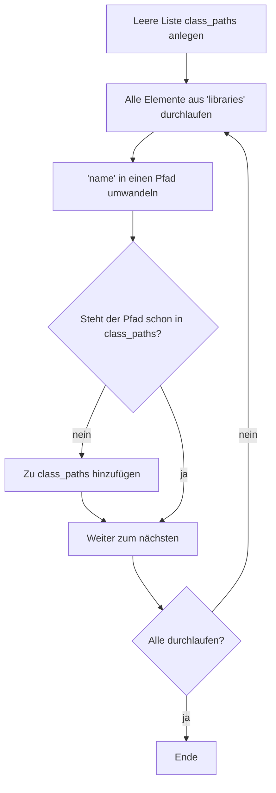

# Den Startbefehl für Minecraft bauen

::: tip An die Leserschaft
Dieses Tutorial enthält keinen vollständigen Quellcode, sondern nur die Denkweise und zentrale Codeausschnitte.
Mehr dazu: [Hinweise zum Tutorial](/de/tutorials/minecraft-launcher/).
:::

Im vorigen Kapitel ging es um den Aufbau des Manifests und die Aufgaben der Schlüssel. Hier geht es darum, die Startargumente zum endgültigen Befehl zusammenzusetzen.

---

## Überblick

Das Zusammensetzen läuft in vier Schritten:

1. **JVM-Argumente zusammenstellen**
2. **Spielargumente zusammenstellen**
3. **ClassPath zusammenstellen**
4. **Platzhalter ersetzen**

Jeder Schritt hat eigene Logik – der Reihe nach.

---

## 1. JVM-Argumente zusammenstellen

### Ablauf
- Lies die Einträge aus dem Array `arguments.jvm` des Manifests.
- Entferne in jedem Argument die Leerzeichen (`replace(" ", "")`) und füge es der Liste `jvm_args` hinzu.

### Mermaid-Diagramm



---

## 2. Spielargumente zusammenstellen

### Ablauf
- Lies die Argumente aus dem Array `arguments.game` des Manifests.
- Entferne ebenfalls die Leerzeichen und hänge sie an `jvm_args` an (die Liste ist dieselbe wie bei den JVM-Argumenten; alles wird gemeinsam an einen Java-Aufruf übergeben).

### Mermaid-Diagramm



---

## 3. ClassPath zusammenstellen

### Ablauf
- Leere Liste `class_paths` anlegen.
- Das Array `libraries` durchlaufen und das Feld `name` jeder Bibliothek in einen Dateipfad umwandeln.
- Ist der Pfad noch nicht in `class_paths`, hinzufügen (um Dopplungen zu vermeiden).
- Am Ende den Pfad zur Haupt-JAR des Spiels (`{version}.jar`) anhängen.

### Maven-Koordinaten in Pfade umwandeln

Algorithmus der Funktion `maven_name_to_path`:

1. **Dateiendung bestimmen**
   - Enthält die Koordinate ein `@`, gilt der Teil danach als Endung (z. B. `@zip`); `@` und alles davor wird abgeschnitten.
   - Ohne `@` ist die Endung `"jar"`.

2. **Koordinaten zerlegen**
   - Den Rest am Doppelpunkt `:` aufteilen.
   - Gültig sind **3 Teile** (`groupId:artifactId:version`) oder **4 Teile** (`groupId:artifactId:version:classifier`).

3. **Pfad bilden**
   - **4 Teile** → `groupId-Pfad/artifactId/version/artifactId-version-classifier.suffix`
   - **3 Teile** → `groupId-Pfad/artifactId/version/artifactId-version.suffix`
   - Sonst → leerer String.

4. **Pfad umwandeln**
   - Punkte `.` in `groupId` durch Schrägstriche `/` ersetzen, passend zur Verzeichnisstruktur.

**Beispiele**:
- `"org.apache.commons:commons-lang3:3.12.0"` →
  `"org/apache/commons/commons-lang3/commons-lang3-3.12.0.jar"`
- `"com.example:my-lib:2.1.0:beta@zip"` →
  `"com/example/my-lib/2.1.0/my-lib-2.1.0-beta.zip"`

> ⚠️ **Zu Pfaden**: Baue möglichst **absolute Pfade**. Bei relativen Pfaden muss das Arbeitsverzeichnis stimmen.

### Mermaid-Diagramm



---

## 4. Zur Zeichenkette verbinden

### JVM-Argumente

`jvm_args` mit Leerzeichen zu einer Zeichenkette verbinden:

```python
jvm_arg = " ".join(jvm_args)
```

### ClassPath

`class_paths` mit dem Trennzeichen des Systems verbinden (am Ende die Haupt-JAR des Spiels anhängen):

```python
delimiter = ";" if os.name == "nt" else ":"   # Windows: Semikolon, sonst Doppelpunkt
class_path = delimiter.join(class_paths)
# Haupt-JAR des Spiels anhängen (Pfad sei version_jar_path)
class_path += delimiter + version_jar_path
```

---

## 5. Platzhalter ersetzen

Nach dem Zusammensetzen müssen die Platzhalter in den JVM-Argumenten durch echte Werte ersetzt werden. Die häufigen:

| Platzhalter | Bedeutung |
|--------|------|
| `${library_directory}` | tatsächlicher Pfad zu `.minecraft/libraries` |
| `${assets_root}` | tatsächlicher Pfad zu `.minecraft/assets` |
| `${assets_index_name}` | Wert des Asset-Index (z. B. `1.16`) |
| `${natives_directory}` | Verzeichnis der nativen Bibliotheken (meist `versions/{version}/natives`) |
| `${game_directory}` | Arbeitsverzeichnis des Spiels (`versions/{version}` bei getrennten Versionen, sonst `versions`) |
| `${launcher_name}` | Name des Launchers (ursprünglich für den offiziellen Launcher gedacht, ohne praktische Wirkung) |
| `${launcher_version}` | Version des Launchers (ebenso) |
| `${version_type}` | Versionsart (Feld `type` im Manifest) |
| `${auth_player_name}` | Spielername (nur Buchstaben, Ziffern, Unterstrich) |
| `${user_type}` | Kontotyp (`Legacy` offline / `Microsoft` Microsoft-Anmeldung) |
| `${auth_uuid}` | UUID des Kontos (am besten ohne Bindestriche) |
| `${auth_access_token}` | Anmeldetoken (offline beliebig, z. B. `"None"`) |
| `${version_name}` | Versionsname (Ordnername) |
| `${classpath}` | **besonderer Platzhalter**: wird durch ClassPath + MainClass ersetzt |

### Beispiel für `${classpath}`

```python
jvm_arg = jvm_arg.replace("${classpath}", f"{class_path} {manifest['mainClass']}")
```

> 💡 **Tipp**: Wenn du jedes Argument in doppelte Anführungszeichen setzt, vermeidest du Probleme mit Leerzeichen in Pfaden – ClassPath und MainClass aber nicht gemeinsam einschließen.

---

## 6. Java-Datei und Speicherparameter ergänzen

Der endgültige Befehl braucht außerdem:
- den vollständigen Pfad zur Java-Datei (z. B. `/path/to/java`);
- die Speichereinstellung (`-Xms` und `-Xmx`).

Beispiel:
```shell
/path/to/java -Xms2G -Xmx2G ... # danach jvm_arg
```

> 📝 **Hinweis**: Der Befehl wird schnell sehr lang; speichere ihn am besten als Skript (`.sh` oder `.bat`).

---
