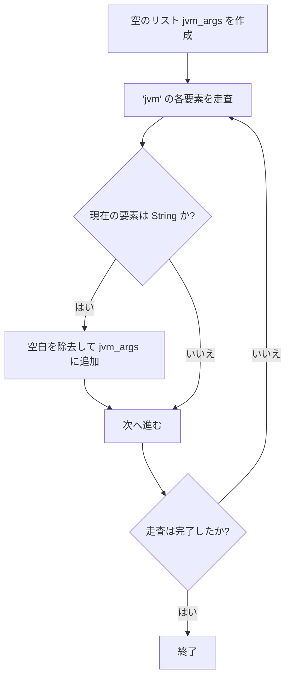
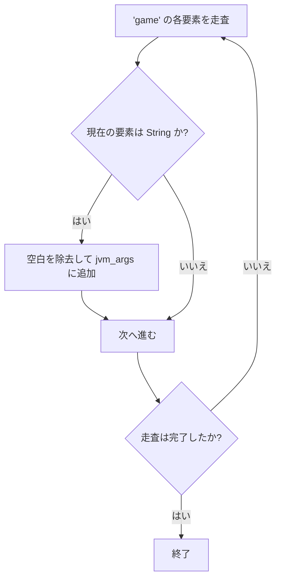
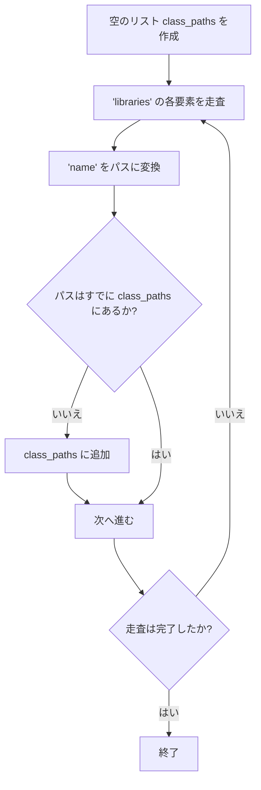

# Minecraft の起動コマンドを組み立てる

::: tip 読者へ
本チュートリアルは完成したソースコードを提供せず、考え方と重要なコード片のみを示します。
詳しい理由は[チュートリアルの説明](/ja/tutorials/minecraft-launcher/)を参照してください。
:::

前章ではマニフェストの構造と各キーの役割を確認しました。本章では起動引数を連結し、最終的な起動コマンドを組み立てる方法を説明します。

---

## 概要

起動引数の組み立ては、大きく次の 4 ステップに分かれます：

1. **JVM 引数の連結**
2. **ゲーム引数の連結**
3. **ClassPath の連結**
4. **プレースホルダーの置換**

それぞれに固有のロジックがあるため、順に説明します。

---

## 1. JVM 引数の連結

### 処理の流れ
- マニフェストの `arguments.jvm` 配列から各要素を読み取ります。
- 各引数の空白を除去し（`replace(" ", "")`）、リスト `jvm_args` に順に追加します。

### Mermaid フローチャート



---

## 2. ゲーム引数の連結

### 処理の流れ
- マニフェストの `arguments.game` 配列から引数を読み取ります。
- 同様に空白を除去して `jvm_args` に追加します（JVM 引数と同じリストを共有し、最終的に 1 つの Java コマンドとして渡されます）。

### Mermaid フローチャート



---

## 3. ClassPath の連結

### 処理の流れ
- 空のリスト `class_paths` を作成します。
- マニフェストの `libraries` 配列を走査し、各ライブラリの `name` を変換関数でファイルパスに変換します。
- 変換後のパスが `class_paths` にまだなければ追加します（重複を避けるため）。
- 最後に、ゲーム本体の JAR（`{version}.jar`）のパスを ClassPath の末尾に追加します。

### Maven 座標からパスへの変換規則

変換関数 `maven_name_to_path` のアルゴリズム：

1. **拡張子の取得**
   - 座標文字列に `@` が含まれる場合、`@` 以降を拡張子（`@zip` など）とし、`@` とその前の部分を切り捨てます。
   - `@` がない場合、拡張子は `"jar"` とします。

2. **座標の分割**
   - 残りの文字列をコロン `:` で分割します。
   - 有効な形式は **3 要素**（`groupId:artifactId:version`）または **4 要素**（`groupId:artifactId:version:classifier`）です。

3. **パスの生成**
   - **4 要素** → `groupIdのパス/artifactId/version/artifactId-version-classifier.suffix`
   - **3 要素** → `groupIdのパス/artifactId/version/artifactId-version.suffix`
   - それ以外 → 空文字列を返します。

4. **パスの変換**
   - `groupId` のドット `.` をスラッシュ `/` に置き換え、ディレクトリ構造に合わせます。

**例**：
- `"org.apache.commons:commons-lang3:3.12.0"` →
  `"org/apache/commons/commons-lang3/commons-lang3-3.12.0.jar"`
- `"com.example:my-lib:2.1.0:beta@zip"` →
  `"com/example/my-lib/2.1.0/my-lib-2.1.0-beta.zip"`

> ⚠️ **パスの注意**：**絶対パス**で組み立てることを強く推奨します。相対パスを使う場合は作業ディレクトリが正しいことを確認してください。

### Mermaid フローチャート



---

## 4. 文字列への連結

### JVM 引数の連結

`jvm_args` を空白で連結して 1 つの文字列にします：

```python
jvm_arg = " ".join(jvm_args)
```

### ClassPath の連結

`class_paths` を OS の区切り文字で連結します（末尾にゲーム本体の JAR を追加）：

```python
delimiter = ";" if os.name == "nt" else ":"   # Windows はセミコロン、それ以外はコロン
class_path = delimiter.join(class_paths)
# ゲーム本体の JAR を追加（パスを version_jar_path とする）
class_path += delimiter + version_jar_path
```

---

## 5. プレースホルダーの置換

連結が終わったら、JVM 引数内のプレースホルダーを実際の値に置き換えます。よく使われるものは次のとおりです：

| プレースホルダー | 意味 |
|--------|------|
| `${library_directory}` | `.minecraft/libraries` の実際のパス |
| `${assets_root}` | `.minecraft/assets` の実際のパス |
| `${assets_index_name}` | アセットインデックスの値（`1.16` など） |
| `${natives_directory}` | ネイティブライブラリのディレクトリ（通常 `versions/{version}/natives`） |
| `${game_directory}` | ゲームの実行ディレクトリ（バージョン分離時は `versions/{version}`、それ以外は `versions`） |
| `${launcher_name}` | ランチャー名（公式が予約していた項目で、実質的な影響はありません） |
| `${launcher_version}` | ランチャーのバージョン（同上） |
| `${version_type}` | バージョンの種類（マニフェストの `type`） |
| `${auth_player_name}` | プレイヤー名（英数字とアンダースコアのみ） |
| `${user_type}` | アカウント種別（`Legacy` オフライン / `Microsoft` マイクロソフトログイン） |
| `${auth_uuid}` | アカウントの UUID（ハイフンなしの形式を推奨） |
| `${auth_access_token}` | ログイントークン（オフライン時は任意の値、例 `"None"`） |
| `${version_name}` | バージョン名（フォルダ名） |
| `${classpath}` | **特殊なプレースホルダー**。ClassPath と MainClass に置き換えます |

### `${classpath}` の置換例

```python
jvm_arg = jvm_arg.replace("${classpath}", f"{class_path} {manifest['mainClass']}")
```

> 💡 **ヒント**：各引数を二重引用符で囲むとパス内の空白などの問題を避けられますが、ClassPath と MainClass をまとめて囲まないよう注意してください。

---

## 6. Java 実行ファイルとヒープサイズの指定

最終的な起動コマンドには、さらに次のものが必要です：
- Java 実行ファイルのフルパス（`/path/to/java` など）
- ヒープサイズの設定（`-Xms` と `-Xmx`）

例：
```shell
/path/to/java -Xms2G -Xmx2G ... # この後に jvm_arg
```

> 📝 **ヒント**：引数は長くなりがちなので、完成したコマンドをスクリプト（`.sh` や `.bat`）として保存すると扱いやすくなります。

---
