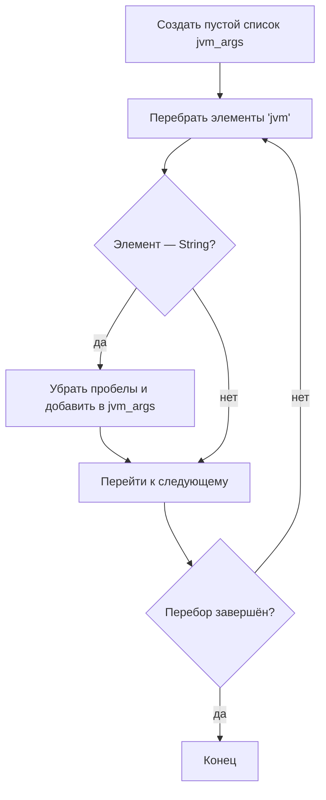
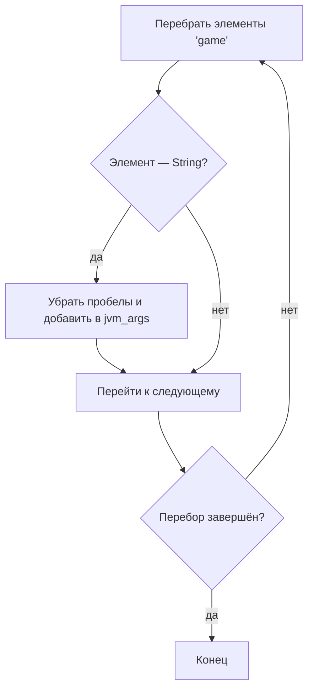
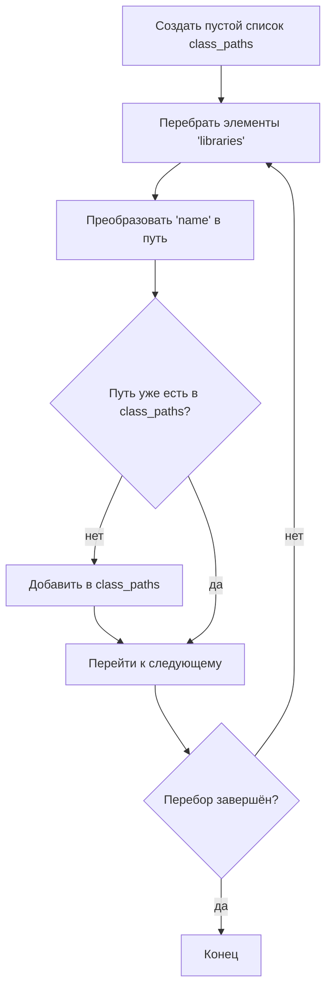

# Собираем команду запуска Minecraft

::: tip Читателю
В этом руководстве нет полного исходного кода — только подход и ключевые фрагменты.
Подробнее: [о руководстве](/ru/tutorials/minecraft-launcher/).
:::

В предыдущей главе разобрана структура манифеста и назначение ключей. Здесь речь о том, как соединить аргументы запуска в итоговую команду.

---

## Общий план

Сборка аргументов запуска состоит из четырёх шагов:

1. **Собрать аргументы JVM**
2. **Собрать аргументы игры**
3. **Собрать ClassPath**
4. **Подставить значения вместо заполнителей**

У каждого шага своя логика — разберём по порядку.

---

## 1. Сборка аргументов JVM

### Как это работает
- Читаем элементы массива `arguments.jvm` из манифеста.
- Убираем пробелы в каждом аргументе (`replace(" ", "")`) и по порядку добавляем в список `jvm_args`.

### Блок-схема Mermaid



---

## 2. Сборка аргументов игры

### Как это работает
- Читаем аргументы из массива `arguments.game` манифеста.
- Так же убираем пробелы и добавляем в `jvm_args` (список общий с аргументами JVM: всё вместе передаётся в одну команду Java).

### Блок-схема Mermaid



---

## 3. Сборка ClassPath

### Как это работает
- Создаём пустой список `class_paths`.
- Перебираем массив `libraries` манифеста и преобразуем поле `name` каждой библиотеки в путь к файлу.
- Если полученного пути ещё нет в `class_paths`, добавляем его (чтобы не было дублей).
- В конце дописываем в ClassPath путь к основному JAR игры (`{version}.jar`).

### Правила преобразования координат Maven в путь

Алгоритм функции `maven_name_to_path`:

1. **Определить расширение**
   - Если в строке координат есть `@`, часть после `@` считается расширением (`@zip`), а `@` и всё до него отбрасывается.
   - Если `@` нет, расширение — `"jar"`.

2. **Разобрать координаты**
   - Остаток строки делим по двоеточию `:`.
   - Допустимы **3 части** (`groupId:artifactId:version`) или **4 части** (`groupId:artifactId:version:classifier`).

3. **Построить путь**
   - **4 части** → `путь groupId/artifactId/version/artifactId-version-classifier.suffix`
   - **3 части** → `путь groupId/artifactId/version/artifactId-version.suffix`
   - Иначе → пустая строка.

4. **Преобразовать путь**
   - Точки `.` в `groupId` заменяем на слэши `/` в соответствии со структурой каталогов.

**Примеры**:
- `"org.apache.commons:commons-lang3:3.12.0"` →
  `"org/apache/commons/commons-lang3/commons-lang3-3.12.0.jar"`
- `"com.example:my-lib:2.1.0:beta@zip"` →
  `"com/example/my-lib/2.1.0/my-lib-2.1.0-beta.zip"`

> ⚠️ **О путях**: настоятельно рекомендуется собирать **абсолютные пути**. Если используете относительные, убедитесь, что рабочий каталог верный.

### Блок-схема Mermaid



---

## 4. Сборка строки

### Аргументы JVM

Соединяем `jvm_args` пробелами в одну строку:

```python
jvm_arg = " ".join(jvm_args)
```

### ClassPath

Соединяем `class_paths` разделителем ОС (в конце добавляем основной JAR игры):

```python
delimiter = ";" if os.name == "nt" else ":"   # в Windows точка с запятой, иначе двоеточие
class_path = delimiter.join(class_paths)
# Добавить основной JAR игры (пусть его путь — version_jar_path)
class_path += delimiter + version_jar_path
```

---

## 5. Подстановка заполнителей

После сборки нужно заменить заполнители в аргументах JVM на реальные значения. Часто используемые:

| Заполнитель | Значение |
|--------|------|
| `${library_directory}` | фактический путь к `.minecraft/libraries` |
| `${assets_root}` | фактический путь к `.minecraft/assets` |
| `${assets_index_name}` | значение индекса ресурсов (например, `1.16`) |
| `${natives_directory}` | каталог нативных библиотек (обычно `versions/{version}/natives`) |
| `${game_directory}` | рабочий каталог игры (`versions/{version}` при раздельных версиях, иначе `versions`) |
| `${launcher_name}` | имя лаунчера (зарезервировано официальным лаунчером, на практике не влияет) |
| `${launcher_version}` | версия лаунчера (то же) |
| `${version_type}` | тип версии (поле `type` в манифесте) |
| `${auth_player_name}` | ник игрока (только латиница, цифры и подчёркивание) |
| `${user_type}` | тип аккаунта (`Legacy` офлайн / `Microsoft` вход через Microsoft) |
| `${auth_uuid}` | UUID аккаунта (лучше без дефисов) |
| `${auth_access_token}` | токен входа (офлайн можно любое значение, например `"None"`) |
| `${version_name}` | имя версии (имя каталога) |
| `${classpath}` | **особый заполнитель**: заменяется на ClassPath + MainClass |

### Пример замены `${classpath}`

```python
jvm_arg = jvm_arg.replace("${classpath}", f"{class_path} {manifest['mainClass']}")
```

> 💡 **Приём**: если обернуть каждый аргумент в двойные кавычки, можно избежать проблем с пробелами в путях, но не оборачивайте ClassPath и MainClass вместе.

---

## 6. Добавление java и параметров памяти

Итоговой команде запуска также нужны:
- полный путь к исполняемому файлу Java (например, `/path/to/java`);
- настройка памяти (`-Xms` и `-Xmx`).

Пример:
```shell
/path/to/java -Xms2G -Xmx2G ... # далее jvm_arg
```

> 📝 **Совет**: команда обычно длинная, поэтому сохраните её в скрипт (`.sh` или `.bat`).

---
