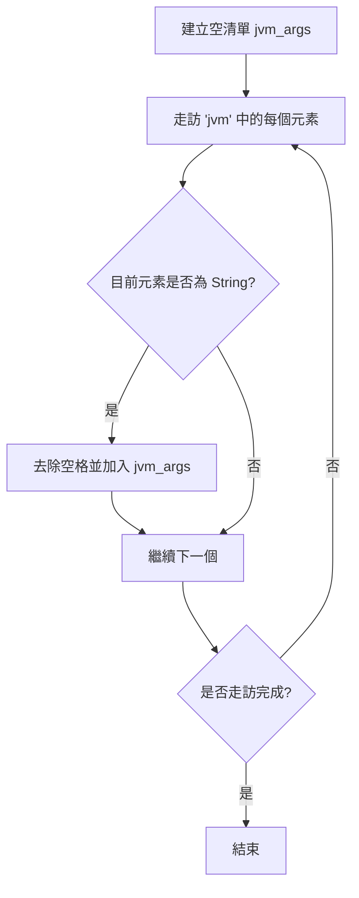
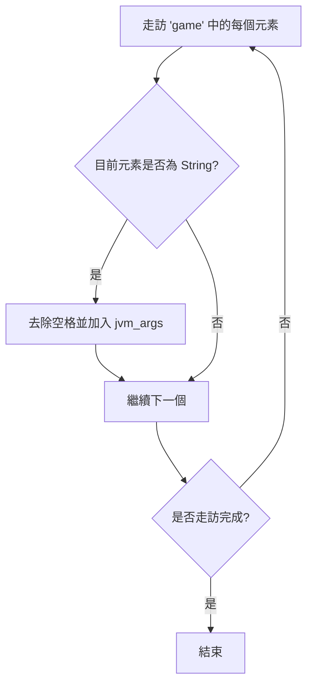
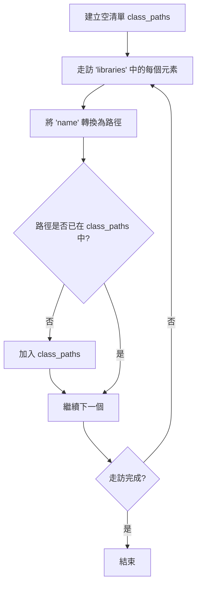

# 建構 Minecraft 啟動指令

::: tip 致讀者
本教學不提供完整原始碼，僅提供思路與關鍵程式碼片段。
詳細原因請參見：[教學說明](/zh-tw/tutorials/minecraft-launcher/)
:::

透過上一章節，您已了解清單檔案的大致結構與鍵值作用。本章將重點說明如何拼接啟動參數，完成最終的啟動命令。

---

## 概述

拼接啟動參數主要分為以下四步：

1. **拼接 JVM 虛擬機參數**
2. **拼接遊戲定義參數**
3. **拼接 ClassPath**
4. **替換佔位符**

每一步都有其特定邏輯，下面逐一拆解。

---

## 1. 拼接 JVM 虛擬機參數

### 流程說明
- 從清單檔案的 `arguments.jvm` 陣列中讀取每個參數項目。
- 對每個參數去除空格（`replace(" ", "")`），並依序存入清單 `jvm_args`。

### Mermaid 流程圖



---

## 2. 拼接遊戲定義參數

### 流程說明
- 從清單檔案的 `arguments.game` 陣列中讀取參數。
- 同樣去除空格後附加到 `jvm_args` 清單中（注意：這裡與 JVM 參數共用同一個清單，最終會一起傳遞給 Java 命令）。

### Mermaid 流程圖



---

## 3. 拼接 ClassPath

### 流程說明
- 建立空清單 `class_paths`。
- 走訪清單檔案中的 `libraries` 陣列，對每個函式庫的 `name` 欄位呼叫轉換函式，將其轉換為對應的檔案路徑。
- 若轉換後的路徑尚未存在於 `class_paths` 中，則加入（避免重複）。
- 最後，在 ClassPath 末尾附加遊戲主 JAR 檔案的路徑（即 `{version}.jar`）。

### Maven 座標轉路徑規則

轉換函式 `maven_name_to_path` 的演算法：

1. **取出副檔名**
   - 若座標字串包含 `@`，則 `@` 之後的部分作為副檔名（如 `@zip`），並截掉 `@` 及其之前的內容；
   - 若沒有 `@`，則預設副檔名為 `"jar"`。

2. **解析座標段**
   - 以冒號 `:` 分割剩餘字串，得到若干部分。
   - 合法格式為 **3 段**（`groupId:artifactId:version`）或 **4 段**（`groupId:artifactId:version:classifier`）。

3. **產生路徑**
   - **4 段** → `groupId路徑/artifactId/version/artifactId-version-classifier.suffix`
   - **3 段** → `groupId路徑/artifactId/version/artifactId-version.suffix`
   - 其他情況 → 回傳空字串。

4. **路徑轉換**
   - 將 `groupId` 中的點號 `.` 替換為斜線 `/`，符合目錄層級結構。

**範例**：
- `"org.apache.commons:commons-lang3:3.12.0"` →
  `"org/apache/commons/commons-lang3/commons-lang3-3.12.0.jar"`
- `"com.example:my-lib:2.1.0:beta@zip"` →
  `"com/example/my-lib/2.1.0/my-lib-2.1.0-beta.zip"`

> ⚠️ **路徑建議**：強烈建議拼接為**絕對路徑**，使用相對路徑時請確保工作目錄正確。

### Mermaid 流程圖



---

## 4. 拼接成字串

### 拼接 JVM 參數

將 `jvm_args` 清單以空格連接為一個字串：

```python
jvm_arg = " ".join(jvm_args)
```

### 拼接 ClassPath

將 `class_paths` 清單以系統分隔符連接（注意末尾附加遊戲主 JAR）：

```python
delimiter = ";" if os.name == "nt" else ":"   # Windows 用分號，其他用冒號
class_path = delimiter.join(class_paths)
# 附加遊戲主 JAR（假設其路徑為 version_jar_path）
class_path += delimiter + version_jar_path
```

---

## 5. 替換佔位符

拼接完成後，需要將 JVM 參數中的佔位符替換為實際值。常用佔位符及其含義如下：

| 佔位符 | 含義 |
|--------|------|
| `${library_directory}` | `.minecraft/libraries` 實際路徑 |
| `${assets_root}` | `.minecraft/assets` 實際路徑 |
| `${assets_index_name}` | 資源索引值（如 `1.16`） |
| `${natives_directory}` | 原生函式庫目錄（通常為 `versions/{version}/natives`） |
| `${game_directory}` | 遊戲執行目錄（版本隔離時為 `versions/{version}`，否則為 `versions`） |
| `${launcher_name}` | 啟動器名稱（原為官方保留，實際無影響） |
| `${launcher_version}` | 啟動器版本（同上） |
| `${version_type}` | 版本型別（即清單中的 `type`） |
| `${auth_player_name}` | 玩家暱稱（僅允許英文字母、數字、底線） |
| `${user_type}` | 帳號型別（`Legacy` 離線 / `Microsoft` 微軟登入） |
| `${auth_uuid}` | 帳號 UUID（建議使用無連字號格式） |
| `${auth_access_token}` | 登入權杖（離線時可填任意值，如 `"None"`） |
| `${version_name}` | 版本名稱（即資料夾名稱） |
| `${classpath}` | **特殊佔位符**，需替換為 ClassPath + MainClass |

### 替換 `${classpath}` 範例

```python
jvm_arg = jvm_arg.replace("${classpath}", f"{class_path} {manifest['mainClass']}")
```

> 💡 **技巧**：對每個參數使用雙引號包裹可避免路徑空格等問題，但注意不要將 ClassPath 與 MainClass 包裹在一起。

---

## 6. 加入 Java 執行檔及堆記憶體參數

最終啟動命令還需要：
- Java 執行檔的完整路徑（如 `/path/to/java`）
- 堆記憶體設定（`-Xms` 與 `-Xmx`）

範例：
```shell
/path/to/java -Xms2G -Xmx2G ... # 後接 jvm_arg
```

> 📝 **提示**：由於參數通常較長，建議將完整命令儲存為腳本（如 `.sh` 或 `.bat`）以便執行。

---
